# Netlify hosting

Wanneer je een website bouwt op je eigen computer, kan alleen jij die bekijken. Om jouw portfolio-website toegankelijk te maken voor docenten, medestudenten en toekomstige werkgevers, moet je de bestanden op een webserver plaatsen. Met Netlify zet je een website in enkele klikken online en automatiseer je het publiceren rechtstreeks vanuit GitHub.

## Leerdoelen

Na dit hoofdstuk kan je:

- Uitleggen wat statische webhosting is en welke voordelen Netlify biedt
- De limieten van het gratis Netlify-plan (300 credits per maand) benoemen en inschatten wat dit betekent voor jouw website
- Een eerste versie van een statische website manueel online plaatsen via drag-and-drop op Netlify
- Het subdomein van een Netlify-project aanpassen naar een herkenbare naam
- De **Powered by Netlify**-badge uitschakelen in de projectinstellingen
- Het **Project ID** opzoeken en een **Personal Access Token** aanmaken op Netlify
- Gevoelige sleutels veilig opslaan als **Repository Secrets** op GitHub en automatische deployments uitvoeren via GitHub Actions
- Een eigen 404-foutpagina (`404.html`) aanmaken met een absoluut stylesheetpad en testen op Netlify

## Wat is Netlify?

[Netlify](https://www.netlify.com/) is een gratis cloudplatform voor het hosten van een <dfn title="Een website die uitsluitend bestaat uit vaste bestanden zoals HTML, CSS, JavaScript en afbeeldingen, zonder dat er een serverprogramma code hoeft uit te voeren">statische website</dfn>. Je hoeft zelf geen webserver te configureren of te onderhouden. Netlify regelt automatisch het <abbr title="Domain Name System: het systeem dat domeinnamen zoals example.com vertaalt naar IP-adressen">DNS</abbr>-beheer en voorziet elke website standaard van een gratis <abbr title="Secure Sockets Layer: de beveiligingstechnologie die zorgt voor een versleutelde HTTPS-verbinding">SSL</abbr>-certificaat (het slotje in de adresbalk).

Normaal gezien kan Netlify rechtstreeks naar een GitHub-repository kijken en automatisch een nieuwe versie publiceren zodra jij wijzigingen pusht. Omdat jouw portfolio-website echter in een **private repository** binnen de GitHub-organisatie `itfactory-tm` staat, mag Netlify daar om veiligheidsredenen niet rechtstreeks bij. We lossen dit op met **GitHub Actions**: een automatiseringshulpmiddel van GitHub dat jouw website na elke push naar Netlify stuurt.

::: tip Bruikbaar voor al je toekomstige projecten
Je kan Netlify niet alleen gebruiken voor dit portfolio, maar voor elke statische website die je tijdens je opleiding bouwt (zoals projecten voor Angular, React of je afstudeerportfolio).
:::

### Limieten van het gratis Netlify-plan

Het gratis plan (**Free**) van Netlify werkt met een maandelijks budget van **300 credits**. Alle acties op je account (zoals nieuwe versies publiceren, dataverkeer en paginabezoeken) verbruiken credits uit dezelfde pot. Op het gratis plan zijn er geen extra kosten mogelijk: zijn je 300 credits op, dan worden je websites tijdelijk gepauzeerd tot de volgende maandelijkse reset.

Voor een persoonlijke portfolio-website is 300 credits per maand ruim voldoende, maar houd wel rekening met het verbruik:

| Onderdeel | Verbruik | Wat betekent dit in de praktijk? |
|---|---|---|
| Productie-deploy | 15 credits per deploy | Maximaal 20 keer per maand publiceren als je verder niets verbruikt |
| Bandbreedte (dataverkeer) | 20 credits per GB | Ongeveer 15 GB dataverkeer per maand |
| Webrequests | 2 credits per 10.000 requests | Ruim 1,5 miljoen verzoeken per maand |

::: warning Push niet onnodig naar main
Elke succesvolle publicatie naar de `main`-branch kost **15 credits**. Werk je aan kleine aanpassingen, test ze dan eerst lokaal in je browser en bundel je wijzigingen in zinvolle commits voordat je naar `main` pusht.
:::

## Stap 1: Eerste website manueel op Netlify plaatsen

Voordat we de automatische koppeling met GitHub Actions kunnen instellen, moet het project al bestaan op Netlify. De snelste manier om een nieuw project aan te maken is via een eenmalige handmatige upload (*drag-and-drop*).

### Account aanmaken

1. Surf naar [app.netlify.com](https://app.netlify.com/) en kies **Sign up with GitHub**.
2. Geef Netlify toestemming om je GitHub-account te gebruiken om in te loggen.
3. Doorloop eventuele welkomstvragen en kies voor het gratis **Free**-plan.

### Een eerste pagina uploaden

1. Maak op je computer een tijdelijke map aan (bijvoorbeeld `netlify-test`) met daarin één bestand: `index.html`.
2. Open `index.html` in PhpStorm, typ `!` gevolgd door <kbd>Tab</kbd> (via [Emmet](./emmet)) om een geldige HTML-basisstructuur te genereren en voeg een titel toe in `<body>`:

```html
<!DOCTYPE html>
<html lang="nl">
<head>
  <meta charset="UTF-8">
  <meta name="viewport" content="width=device-width, initial-scale=1.0">
  <title>Mijn Portfolio</title>
</head>
<body>
  <h1>Welkom op mijn portfolio</h1>
</body>
</html>
```

3. Ga in het Netlify-dashboard naar **Projects** (of **Sites**) en kies **Add new project**: (https://app.netlify.com/start).
2. Sleep je map `netlify-test` naar het uploadvak onder de titel **Upload your project files** in je browser.


Netlify publiceert je map onmiddellijk en genereert een willekeurige <abbr title="Uniform Resource Locator: het adres van een webpagina of bestand">URL</abbr> (zoals `https://vrolijke-lama-123456.netlify.app`).

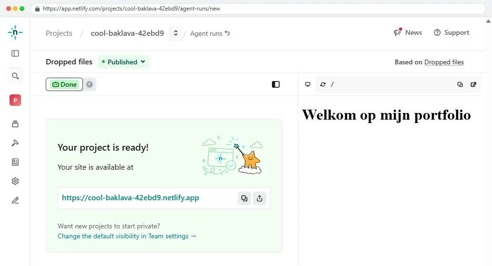


## Stap 2: Subdomein aanpassen en de Netlify-badge uitschakelen

Na het aanmaken van je project heeft je website nog een willekeurig webadres en toont Netlify rechtsonder op de pagina een eigen badge. Beide instellingen pas je aan onder **Project configuration > General**.

### Een eigen subdomein instellen

Een <dfn title="Het voorvoegsel voor een hoofddomeinnaam, zoals jouw-naam in jouw-naam.netlify.app">subdomein</dfn> zoals `voornaam-achternaam-portfolio.netlify.app` oogt veel professioneler op je cv of bij het delen van je werk.

1. Open jouw project in het Netlify-dashboard.
2. Klik in het linkermenu op **Project configuration** en blijf op het tabblad **General**.
3. Zoek de sectie **Project details** en klik op **Change project name**.
4. Kies een duidelijke, unieke naam (bijvoorbeeld `voornaam-achternaam`) en sla op. Je website is voortaan bereikbaar via `https://jouw-gekozen-naam.netlify.app`.

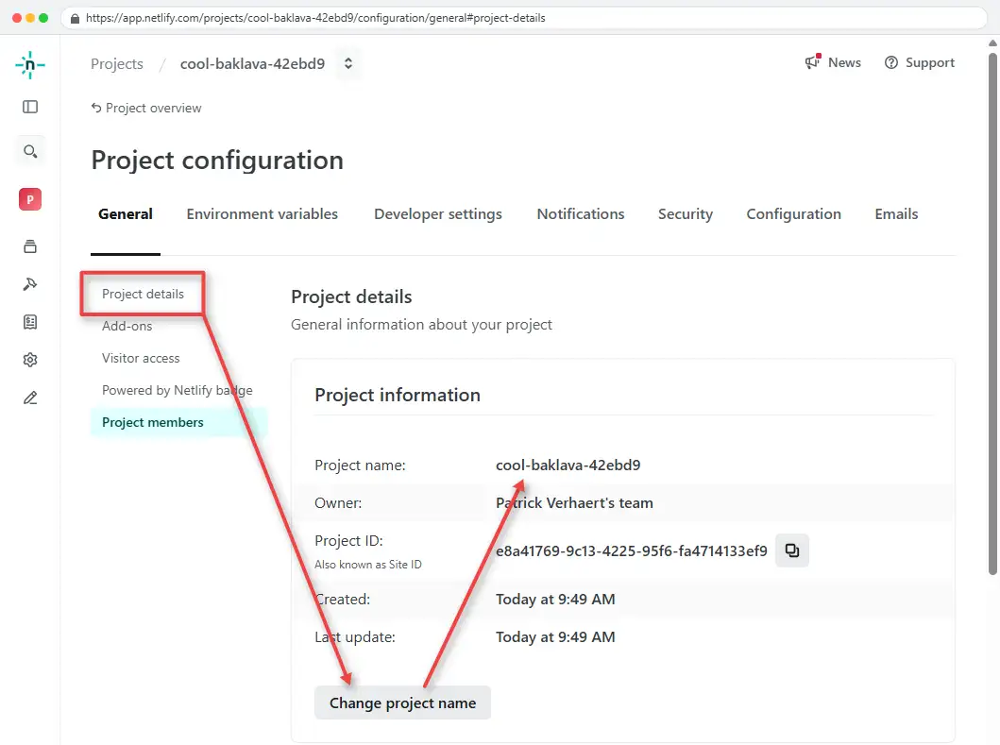

### De Powered by Netlify-badge uitschakelen

Op gratis plannen toont Netlify standaard een kleine **Powered by Netlify**-badge rechtsonder op elke publieke webpagina. Voor een professioneel portfolio kan je deze badge eenvoudig uitzetten:

1. Ga opnieuw naar **Project configuration > General**.
2. Scroll naar de sectie **Powered by Netlify badge**.
3. Klik op **Configure**, vink **Show the badge on this project** uit en sla je wijziging op.

De aanpassing wordt onmiddellijk actief bij het volgende paginabezoek; je hoeft hiervoor geen nieuwe deploy uit te voeren.

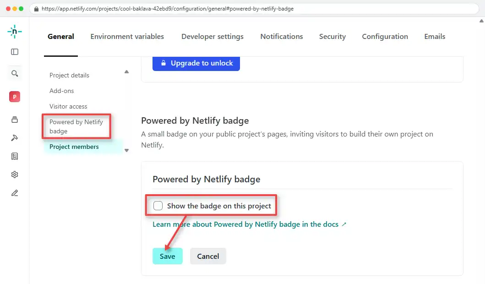

## Stap 3: Project ID en Personal Access Token ophalen

Om GitHub Actions toestemming te geven om automatisch nieuwe versies naar jouw Netlify-project te <dfn title="Het automatisch of handmatig plaatsen van code en bestanden op een live webserver zodat bezoekers de website kunnen bekijken">deployen</dfn>, heeft GitHub twee gegevens nodig: het **Project ID** (wie ontvangt de bestanden?) en een **Personal Access Token** (heeft GitHub wel toestemming?).

### Het Project ID kopiëren

In oudere versies van Netlify heette deze code **Site ID**. In de huidige interface vind je dit terug als **Project ID**:

1. Ga in jouw Netlify-project naar **Project configuration > General**.
2. Kijk onder **Project details > Project information**.
3. Kopieer de waarde achter **Project ID** (een reeks letters, cijfers en koppeltekens) en bewaar deze tijdelijk in een kladblokbestand als `NETLIFY_SITE_ID=`.

````text {1}
NETLIFY_SITE_ID=your-project-id
NETLIFY_AUTH_TOKEN=your-personal-access-token
````

### Een Personal Access Token aanmaken

Een <abbr title="Personal Access Token: een geheime sleutel die een applicatie of script namens jou toegang geeft tot een dienst zonder je wachtwoord te delen">PAT</abbr> werkt als een speciale toegangssleutel voor automatisering.

1. Klik rechtsboven in Netlify op je profielicoon en kies **User settings**.
2. Open in het linkermenu het tabblad **Applications** (rechtstreeks bereikbaar via [app.netlify.com/user/applications](https://app.netlify.com/user/applications)).
3. Klik onder **Personal access tokens** op **New access token**.  
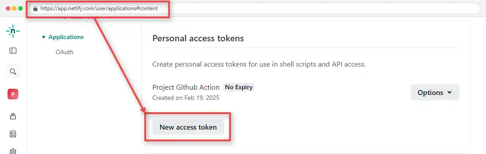 
4. Geef een duidelijke omschrijving op, bijvoorbeeld `Portfolio 1WT`.
5. Kies bij **Expiration** een vervaldatum die minstens het volledige academiejaar (of semester) dekt. Kies om veiligheidsredenen bij voorkeur niet voor *No expiration*.
6. Klik op **Generate token**.  
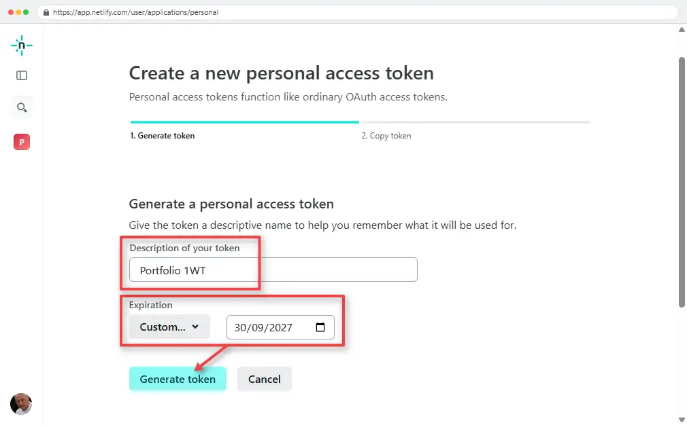
7. Kopieer het gegenereerde token **onmiddellijk** naar je tijdelijke kladblokbestand. Zodra je dit venster sluit, kan je het token nooit meer opnieuw bekijken.

````text {2}
NETLIFY_SITE_ID=your-project-id
NETLIFY_AUTH_TOKEN=your-personal-access-token
````

## Stap 4: Automatisch deployen met GitHub Actions

In jouw portfolio-repository staat al een kant-en-klaar workflowbestand op de locatie `.github/workflows/netlify-deploy.yml`. Dit bestand is geschreven in <abbr title="YAML Ain't Markup Language: een goed leesbaar bestandsformaat dat vaak gebruikt wordt voor configuratiebestanden">YAML</abbr> en beschrijft een <abbr title="Continuous Integration / Continuous Deployment: het automatisch testen en publiceren van code bij elke wijziging">CI/CD</abbr>-pijplijn.

### Hoe werkt het workflowbestand?

Open `.github/workflows/netlify-deploy.yml` in PhpStorm en bekijk de inhoud:

```yaml
# triggers the workflow when a push is made to the main branch
on:
  push:
    branches: [ main ]

jobs:
  # The job (aka runner) "build_and_deploy" will run on an ubuntu-latest machine
  build_and_deploy:
    name: Build and deploy
    runs-on: ubuntu-latest

    # The job contains two steps that will be executed sequentially
    steps:
      # Step 1: Check out the main branch
      - name: Checkout the main branch
        uses: actions/checkout@v7.0.1

      # Step 2: Deploy the site to Netlify
      - name: Deploy Site to Netlify
        uses: nwtgck/actions-netlify@v4.0.0
        with:
          publish-dir: './'
          production-branch: main
          github-token: ${{ secrets.GITHUB_TOKEN }}
          deploy-message: "Deploy from GitHub Actions"
          production-deploy: true
        env:
          NETLIFY_AUTH_TOKEN: ${{ secrets.NETLIFY_AUTH_TOKEN }}
          NETLIFY_SITE_ID: ${{ secrets.NETLIFY_SITE_ID }}
```

Dit script doet bij elke push naar `main` automatisch het volgende:

1. **`on: push: branches: [ main ]`**: De workflow start telkens wanneer je een commit naar de `main`-branch pusht.
2. **`Checkout the main branch`**: GitHub start een tijdelijke Linux-server (`ubuntu-latest`) en haalt de bestanden van je `main`-branch op.
3. **`Deploy Site to Netlify`**: De actie `nwtgck/actions-netlify@v4.0.0` verstuurt de volledige hoofdmap (`publish-dir: './'`) naar Netlify als productiewebsite (`production-deploy: true`).
4. **`env`**: De actie leest twee geheime variabelen uit: `NETLIFY_AUTH_TOKEN` (jouw Personal Access Token) en `NETLIFY_SITE_ID` (jouw Project ID op Netlify).

::: tip Waarom staat er NETLIFY_SITE_ID terwijl Netlify het Project ID noemt?
Netlify heeft de naam **Site ID** in zijn webinterface veranderd naar **Project ID**, maar de gebruikte GitHub Action (`nwtgck/actions-netlify`) verwacht technisch gezien nog steeds de omgevingsvariabele `NETLIFY_SITE_ID`. Je vult bij de waarde van `NETLIFY_SITE_ID` dus gewoon jouw **Project ID** in.
:::

### Secrets toevoegen in GitHub

Je mag wachtwoorden en tokens **nooit** rechtstreeks in je code of YAML-bestand zetten, want iedereen die toegang heeft tot de repository kan ze dan lezen. Daarom bewaar je ze als een <dfn title="Een versleutelde omgevingsvariabele in de instellingen van een GitHub-repository die alleen tijdens een GitHub Actions-run leesbaar is">repository secret</dfn>:

1. Open jouw portfolio-repository op GitHub (binnen de organisatie `itfactory-tm`).
2. Klik bovenaan op het tabblad **Settings**.  
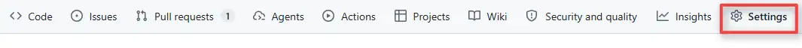
3. Kies in het linkermenu voor **Secrets and variables > Actions**.
4. Klik op de groene knop **New repository secret**.
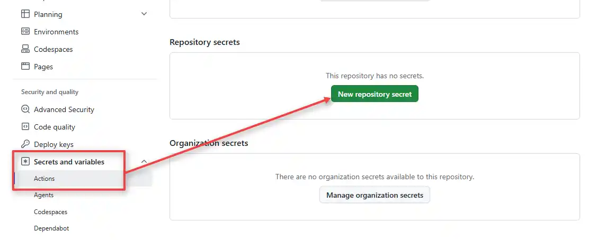
5. Maak een eerste secret aan:
   - **Name:** `NETLIFY_AUTH_TOKEN`
   - **Secret:** plak hier jouw Personal Access Token uit Stap 3.
   - Klik op **Add secret**.
6. Klik opnieuw op **New repository secret** en maak het tweede secret aan:
   - **Name:** `NETLIFY_SITE_ID`
   - **Secret:** plak hier jouw Project ID uit Stap 3.
   - Klik op **Add secret**.

::: danger Let op de exacte spelling
De namen `NETLIFY_AUTH_TOKEN` en `NETLIFY_SITE_ID` zijn hoofdlettergevoelig en moeten exact overeenkomen met de namen in `.github/workflows/netlify-deploy.yml`. Een spelfout zorgt ervoor dat de deployment mislukt.
:::

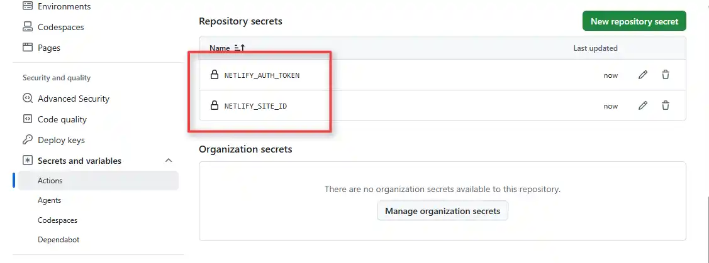

### De automatische deployment testen

Nu alle instellingen klaarstaan, voer je de workflow voor het eerst uit:

1. Ga in je GitHub-repository bovenaan naar het tabblad **Actions**.
2. Selecteer de workflow (of open de laatst uitgevoerde run) en klik rechtsboven op **Re-run all jobs** (of push een eerste wijziging vanuit PhpStorm naar `main`).  
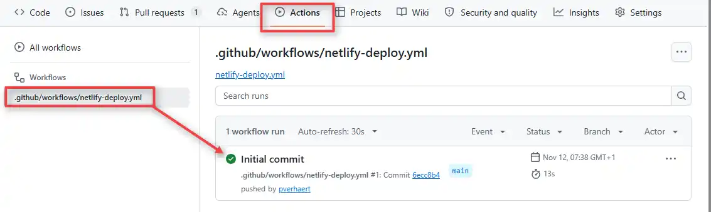
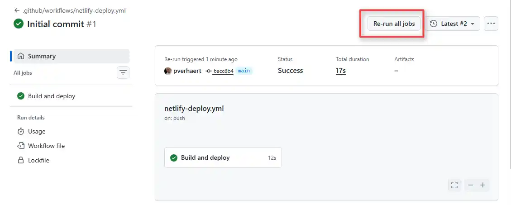
3. Wacht enkele seconden tot het vinkje groen kleurt.
4. Surf naar `https://jouw-gekozen-naam.netlify.app` en controleer of jouw website live staat.

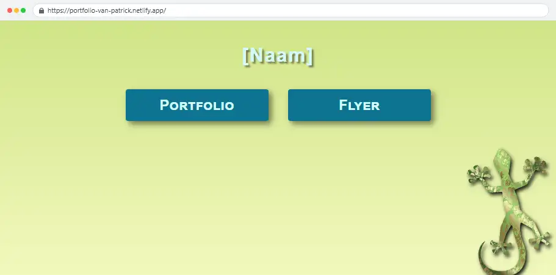

::: warning Elke push naar main staat meteen online
Vanaf nu wordt elke push naar `main` automatisch gepubliceerd op je publieke Netlify-URL. Controleer je HTML en <abbr title="Cascading Style Sheets: de stijlen- en opmaaktaal voor het web">CSS</abbr> altijd eerst lokaal in de browser voordat je pusht, en zorg dat je geen onafgewerkte testpagina's online zet.
:::

## Stap 5: Een eigen 404-foutpagina toevoegen

Wanneer een bezoeker naar een pagina surft die niet bestaat op jouw website, toont Netlify standaard een Engelstalige 404-foutmelding. Voor je portfolio maak je daarom een eigen, gepersonaliseerde foutpagina die aansluit bij de huisstijl van jouw website.

### Het bestand 404.html aanmaken

Netlify herkent automatisch een bestand met de naam `404.html` zodra het in de **hoofdmap (root)** van je project staat.

1. Maak in de hoofdmap van je project een nieuw bestand `404.html` aan.
2. Voeg de HTML-structuur toe en verwijs naar je stylesheet met een **absoluut pad** (beginnend met `/`):

```html
<!DOCTYPE html>
<html lang="nl">
<head>
  <meta charset="UTF-8">
  <meta name="viewport" content="width=device-width, initial-scale=1.0">
  <title>404 - Pagina niet gevonden</title>
  <link rel="stylesheet" href="/css/404.css">
</head>
<body id="error404">
  <main>
    <h1>Oeps!</h1>
    <h2>404 - Deze pagina bestaat niet</h2>
    <p><a href="/">Terug naar de startpagina</a></p>
  </main>
</body>
</html>
```

::: danger Gebruik altijd een absoluut pad in 404.html
Link naar je CSS-bestand en naar je startpagina altijd met een voorafgaande schuine streep (`/`), zoals `href="/css/404.css"` en `href="/"`. Een 404-fout kan namelijk ook optreden op een dieper adres, zoals `https://jouw-naam.netlify.app/projecten/bestaat-niet`. Met een relatief pad (`css/404.css`) zou de browser tevergeefs zoeken in `/projecten/css/404.css`, waardoor je foutpagina zonder opmaak getoond wordt.
:::

### De 404-pagina vormgeven en testen

1. Maak in de hoofdmap een submap **css** met daarin het bestand **404.css**.
2. Voeg onderstaande code toe aan het **404.css**-bestand. 

```css
body {
    margin: 0;
    height: 100%;
}

#error404 {
    min-height: 100vh;
    display: flex;
    flex-direction: column;
    align-items: center;
    justify-content: center;
    text-align: center;
    font-family: sans-serif;
    color: #dd6915;
    background-color: #faf0e7;
}

#error404 h1 {
    font-size: 5rem;
    margin-bottom: 0.5rem;
}

#error404 h2 {
    font-size: 1.25rem;
    font-weight: 400;
    margin-bottom: 1.5rem;
}
```

3. Commit en push je nieuwe bestanden naar de `main`-branch (zoals geleerd in [Git Basics](./git)).
````bash
git add .
git commit -m "Add 404 page"
git push
````
4. Wacht tot de GitHub Action groen kleurt en test je eigen foutpagina door naar een onbestaand adres te surfen, bijvoorbeeld `https://jouw-gekozen-naam.netlify.app/abc/xyz`.

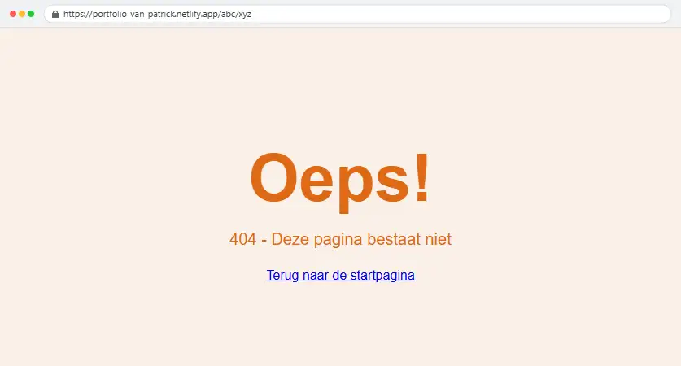

<PageSummary>

### Overzicht van sleutels en instellingen

| Wat | Waar te vinden of in te stellen | Gebruikt voor |
|---|---|---|
| Handmatige start | Netlify: **Projects > Add new project > Deploy manually** | Eerste project aanmaken via drag-and-drop |
| Eigen subdomein | Netlify: **Project configuration > General > Change project name** | Leesbare URL (`naam.netlify.app`) |
| Netlify-badge uitzetten | Netlify: **Project configuration > General > Powered by Netlify badge** | Badge verbergen rechtsonder |
| Project ID | Netlify: **Project configuration > General > Project information** | Waarde voor `NETLIFY_SITE_ID` |
| Personal Access Token | Netlify: **User settings > Applications > Personal access tokens** | Waarde voor `NETLIFY_AUTH_TOKEN` |
| Repository Secrets | GitHub: **Settings > Secrets and variables > Actions** | Veilige opslag voor beide tokens |
| Eigen 404-pagina | `404.html` in de hoofdmap van je project | Eigen foutpagina bij onbestaande URL's |

### Regels en naamgeving

- **Exacte secret-namen:** Gebruik exact `NETLIFY_AUTH_TOKEN` en `NETLIFY_SITE_ID` in GitHub Secrets.
- **Nooit in code:** Zet tokens en sleutels nooit rechtstreeks in `.github/workflows/netlify-deploy.yml` of HTML-bestanden.
- **Publish directory:** Laat `publish-dir: './'` staan als `index.html` in de hoofdmap van je repository staat.
- **Vervaldatum token:** Kies een vervaldatum die het hele academiejaar dekt, zodat je token niet plots verloopt.
- **Absoluut pad in `404.html`:** Start links naar CSS en de startpagina altijd met `/` (bijvoorbeeld `/css/stijl.css` en `/`).

### Veelgemaakte fouten

- Vergeten om eerst manueel een project via drag-and-drop aan te maken, waardoor je nog geen Project ID hebt.
- De waarde van `NETLIFY_SITE_ID` verwarren met de projectnaam of URL; je moet het unieke **Project ID** kopiëren.
- Het Personal Access Token niet meteen kopiëren bij het aanmaken, waardoor je een nieuw token moet genereren.
- Een typefout maken in de naam van een GitHub Secret, waardoor de GitHub Action met een foutmelding stopt.
- Een relatief pad (`css/stijl.css`) gebruiken in `404.html`, waardoor de opmaak verdwijnt bij foutieve URL's in submappen.

### Tips voor beginners

- Bewaar je **Project ID** en je net aangemaakte token heel even in een tijdelijk tekstbestand tijdens het instellen, en verwijder dat bestand zodra beide GitHub Secrets zijn opgeslagen.
- Gebruik je browser incognitovenster of een harde vernieuwing (`Ctrl + Shift + R`) als je wijzigingen na een geslaagde deploy niet meteen ziet.
- Houd je creditverbruik in het oog onder **Billing** in Netlify als je veel testen uitvoert; elke push naar `main` kost 15 van je 300 maandelijkse credits.

</PageSummary>
